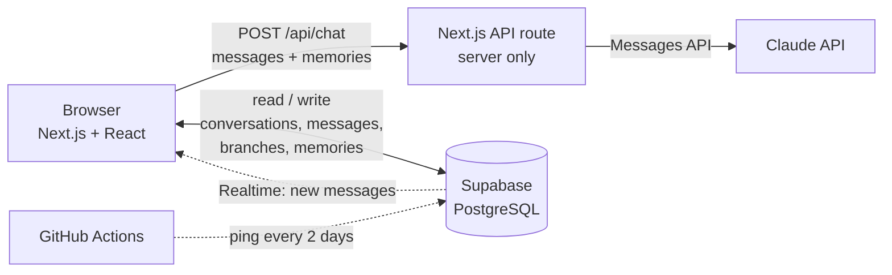

# Claude Workspace

[](https://github.com/AaliyaSalz/claude-workspace/actions/workflows/ci.yml)
[](https://github.com/AaliyaSalz/claude-workspace/actions/workflows/supabase-keepalive.yml)


A full-stack AI productivity app built on the Claude API that explores features missing from current AI chat interfaces. Built in the summer after my freshman year at Vanderbilt as a demonstration of product thinking and technical ability.

**[Try it live →](https://claude-workspace-sandy.vercel.app)**

---

## Why I Built This

Current AI chat interfaces are powerful but limited. Conversations are linear, context disappears, and collaboration is impossible. I built Claude Workspace to explore what a more powerful, flexible AI workspace could look like — one designed for researchers, students, and teams who need more than a simple chat window.

The project also reflects my broader interest in applying AI to high-stakes domains, particularly healthcare, where better context retention, collaboration, and annotation tools could meaningfully improve clinical workflows and patient outcomes.

---

## Features

### 📌 Pinned Messages
Save any message to a persistent sidebar with one click. Pinned messages stay visible as you scroll and jump back to the original message when clicked.

### ✂️ Text Selection Pinning
Highlight any portion of a response and pin just that snippet — not the whole message. A floating "Pin Selection" popup appears on highlight, and snippets link back to their source message.

### 🌿 Conversation Branching
Fork any conversation at any point to explore a different direction without losing the original thread. Switch between branches from the sidebar. Each branch is saved independently to the database.

### 👥 Multi-User Shared Conversations
Share a conversation via a generated link. Multiple users can join, send messages, and see each other's responses in real time — powered by Supabase Realtime.

### 🧠 Structured Memory
Explicitly save facts for Claude to remember. Memories are injected into every message as a system prompt, so Claude references them naturally without being told each time.

---

## Tech Stack

- **Frontend:** Next.js, React, TypeScript, Tailwind CSS
- **Backend:** Next.js API Routes
- **Database:** Supabase (PostgreSQL + Realtime)
- **AI:** Anthropic Claude API (claude-sonnet-4-5)
- **Deployment:** Vercel
- **CI/CD:** GitHub Actions (lint, type check and build on every pull request), Vercel auto-deploys from `main`

---

## Architecture



- **The Anthropic API key never reaches the browser.** All Claude calls go through `app/api/chat/route.ts` on the server.
- **Row-level security** enforces privacy in the database itself: every table only returns rows from conversations you own or have joined through a share link, so the public Supabase key can't be used to read other people's chats. See [`supabase/migrations`](supabase/migrations).
- **Memory** works by injecting saved facts into the system prompt on every request.
- **Shared conversations** subscribe to Supabase Realtime, so every participant sees new messages as they arrive.
- **A scheduled GitHub Action** pings Supabase every 2 days so the free-tier project never auto-pauses.

### Data model

| Table | Purpose |
|---|---|
| `conversations` | One row per conversation: its owner and an optional `share_token` for share links |
| `conversation_members` | Who may see each conversation: the owner, plus anyone who opened its share link |
| `messages` | Messages per conversation: role, content, sender name and account, pinned state |
| `branches` | Links a branch to the parent conversation and the message it forked from |
| `memories` | Facts saved for Claude to remember |

### Project structure

```
app/
  api/chat/route.ts   # Server route that calls the Claude API
  page.tsx            # Main workspace UI
  layout.tsx          # Root layout and page metadata
lib/
  auth.ts             # Sign-in (Google or guest) and the signed-in user's name
  supabase.ts         # Supabase client
  db.ts               # Database helpers (conversations, messages, branches, memories)
supabase/migrations/  # SQL for the database schema and row-level security policies
.github/workflows/
  ci.yml                  # Lint, type check and build on every PR
  supabase-keepalive.yml  # Keeps the Supabase project awake
```

---

## Getting Started

1. Clone the repo
```bash
   git clone https://github.com/AaliyaSalz/claude-workspace.git
   cd claude-workspace
```

2. Install dependencies
```bash
   npm install
```

3. Copy the example environment file and fill in your keys:
```bash
   cp .env.example .env.local
```

| Variable | Where to find it |
|---|---|
| `NEXT_PUBLIC_SUPABASE_URL` | Supabase → Project Settings → Data API |
| `NEXT_PUBLIC_SUPABASE_ANON_KEY` | Supabase → Project Settings → API Keys (anon or publishable key) |
| `ANTHROPIC_API_KEY` | [console.anthropic.com](https://console.anthropic.com) → API Keys. Server-side only |

4. Run the development server
```bash
   npm run dev
```

5. Open [http://localhost:3000](http://localhost:3000)

### Authentication setup (Supabase dashboard)

Sign-in uses Supabase Auth: a Google account, or a named guest with no account at all (anonymous sign-in). Google names come from the account, so people can't post as someone else; guests show as "Name (guest)".

1. **Authentication → Sign In / Providers:** turn on **Allow anonymous sign-ins** for guests.
2. **Google:** in Google Cloud Console, set up the OAuth consent screen and create an OAuth client ID (type *Web application*) with the redirect URI `https://<project-ref>.supabase.co/auth/v1/callback`. Paste its Client ID and Secret into Supabase's **Google** provider and enable it.
3. **Authentication → URL Configuration:** set **Site URL** to your production URL and add redirect URLs for production, Vercel previews and `http://localhost:3000/**`.

The sign-in screen shows only the methods that are switched on.

### Database setup

Run each file in [`supabase/migrations`](supabase/migrations) in order in Supabase → **SQL Editor**. They add conversation owners and members, and turn on row-level security.

### Checks

The same checks CI runs on every pull request:

```bash
npm run lint
npm run typecheck
npm run build
```

---

## Roadmap

Planned work is tracked in [GitHub Issues](https://github.com/AaliyaSalz/claude-workspace/issues) and grouped into milestones:

- **v0.2 Polish:** streaming responses, code highlighting with copy buttons, mobile layout, message actions
- **v0.3 Accounts & security:** real sign-in with Supabase Auth, row-level security, rate limiting on the chat API
- **v0.4 Smarter memory:** automatic memory extraction with pgvector retrieval
- **v0.5 Collaboration:** presence and typing indicators, @claude mentions, visual branch tree

Every change goes through a branch and pull request with CI checks before merging to `main`.

---

## About

Built by Aaliya Salzberg, an undergraduate at Vanderbilt University studying Computer Science, Medicine Health & Society, and Artificial Intelligence. I'm interested in product management at the intersection of AI and healthcare — building tools that improve the lives of patients and providers.

[LinkedIn](http://www.linkedin.com/in/aaliya-salzberg) · [Live Demo](https://claude-workspace-sandy.vercel.app)